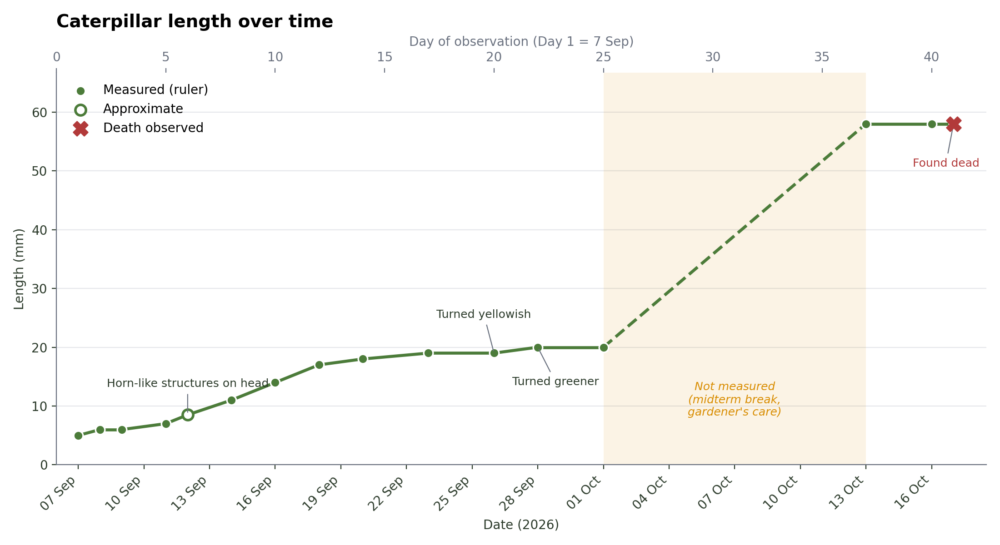
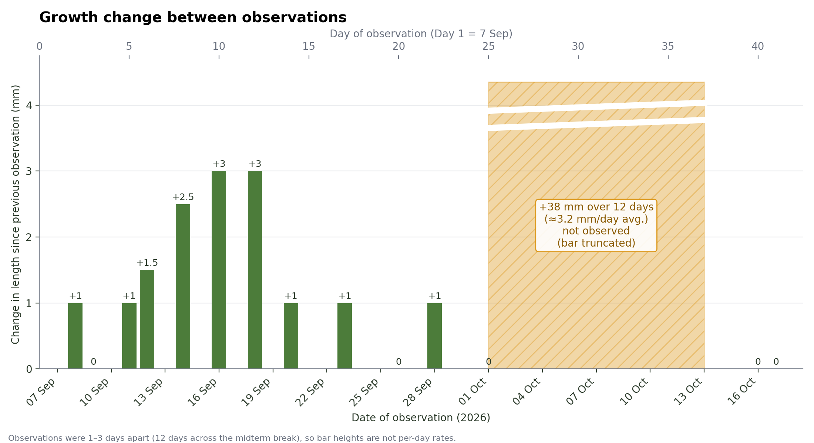
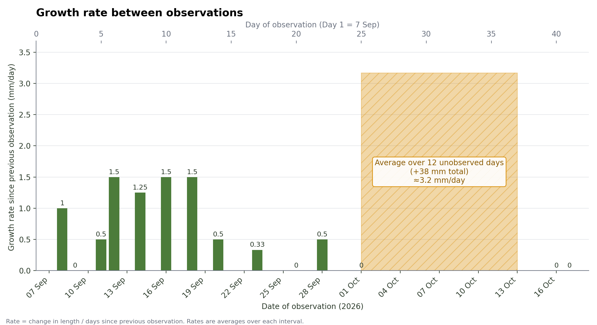

# Caterpillar Growth Observations

Data and plots from a timed observation of a swallowtail caterpillar (found on a bael plant) for the *Principles on Science* (POS) course at Ashoka University (Monsoon 2026). The caterpillar was observed from 7 September to 17 October 2026 and measured with a 30 cm ruler (1 mm resolution).

Author: Vihaan Jakhetiya
Prof. Somak Raychaudhury & Shraddha Karve


## Graphs

| Graph | What it shows |
| --- | --- |
| `figures/length_over_time.png` | Length (mm) vs. date, with notable events (horn-like structures, colour changes, death) annotated |
| `figures/growth_change.png` | Change in length since the previous observation |
| `figures/growth_rate.png` | Growth rate (mm/day) between observations, which accounts for uneven spacing |





## Quick start

```bash
git clone <https://github.com/OderintV/caterpillar-growth>
cd caterpillar-growth
python3 -m venv .venv && source .venv/bin/activate   # Windows: .venv\Scripts\activate
pip install -r requirements.txt
python3 plot_growth.py
```

Figures are written to `figures/`. Optional arguments: `--csv path/to/file.csv` and `--out output_folder`.

## Files

- `observations.csv` – the measurements and notes (one row per observation)
- `plot_growth.py` – loads the CSV and draws all three graphs
- `requirements.txt` – Python dependencies (matplotlib, pandas)

## `observations.csv` columns

| Column | Meaning |
| --- | --- |
| `date` | Observation date (YYYY-MM-DD) |
| `day_number` | Days since 7 Sep 2026, counting 7 Sep as Day 1 (calculated from the date) |
| `journal_day_label` | Day number as written in the original observation journal |
| `length_mm` | Length in millimetres |
| `measurement` | `ruler` (measured) or `approx` (estimated) |
| `event` | Short label for notable events, used for graph annotations |
| `notes` | Other observations (behaviour, leaves, frass, etc.) |

Length change is computed in code from `length_mm`, not stored in the CSV.

## Notes and limitations

- **No measurements 2–12 Oct.** The caterpillar was with the gardener during the midterm break. The 13 Oct reading (58 mm) is 38 mm above the last reading (20 mm), but when that growth happened is unknown. The graphs mark this gap clearly rather than implying steady growth.
- **Uneven spacing.** Observations were 1–3 days apart, so bar heights in the growth-change graph are not per-day rates; use the growth-rate graph to compare intervals.
- **Cause of death was not determined.** Pupation was not observed.
